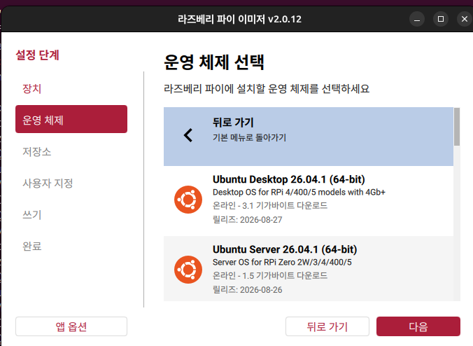
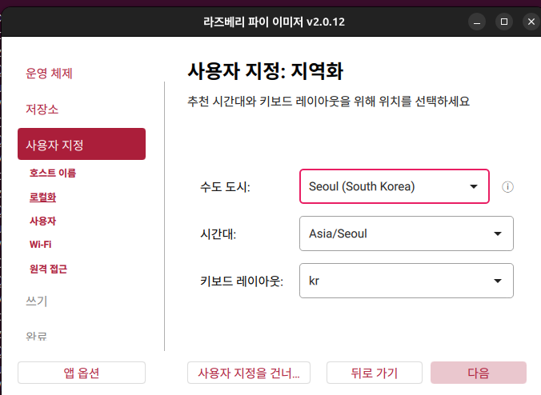
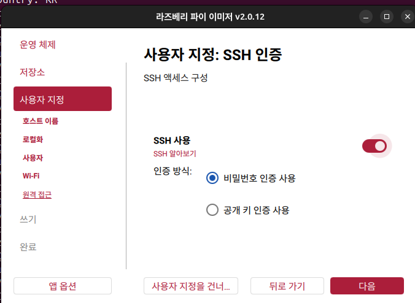

# Raspberry Pi 4B (TurtleBot3용) - Ubuntu에서 SD카드에 OS 설치 방법

> 호스트 OS: Linux Ubuntu (20.04 / 22.04 / 24.04)
> 대상 보드: Raspberry Pi 4B 2GB / 4GB / 8GB (TurtleBot3 Burger / Waffle Pi 기본 SBC)
> TurtleBot3 정석 조합: Ubuntu Server 22.04 LTS 64-bit + ROS 2 Humble

## 1. 준비물

1. Raspberry Pi 4B 본체 (TurtleBot3 내장형)
2. microSD 카드 32GB 이상 권장 (TurtleBot3 공식 권장, Class 10 / A1 이상, 64GB/128GB 가능)
3. SD카드 리더기 (TurtleBot3 패키지에 미포함, 별도 준비)
4. Ubuntu PC
5. 인터넷 연결
6. 필수: micro-HDMI 케이블, 키보드, 모니터 (TurtleBot e-Manual 필수 요구)
7. 필수: TurtleBot3용 SMPS / 5V 3A 어댑터 (Pi 4B 정격, 배터리로 OS 설치 금지)

## 2. 방법 개요

Ubuntu에서는 `Raspberry Pi Imager`를 사용하는 것이 가장 간단하고 안전함.
`dd` 명령으로도 가능하지만 파티션, 부트로더 설정 실수 위험이 있어 Imager 권장.

## 3. Raspberry Pi Imager 설치 (Ubuntu)

[install download](https://downloads.raspberrypi.com/imager/imager_latest_amd64.AppImage)

터미널을 열고 다음 중 하나 실행:

### 3-1. snap으로 설치 (권장, Ubuntu 22.04/24.04)

```bash
sudo snap install rpi-imager
```

### 3-2. apt로 설치 (Ubuntu 24.04 이상)

```bash
sudo apt update
sudo apt install rpi-imager
```

### 3-3. 직접 다운로드 (snap/apt가 안 될 때)

1. https://www.raspberrypi.com/software/ 접속
2. `Raspberry Pi Imager for Linux` .deb 다운로드
3. 설치:
```bash
sudo apt install ./imager_*.deb
```

실행:
```bash
rpi-imager
```

## 4. SD카드 삽입 및 장치 확인

1. SD카드를 리더기에 꼽아 Ubuntu PC에 연결
2. 장치명 확인 (실수로 시스템 디스크를 지우지 않기 위해 필수):

```bash
lsblk -p
```

예시:
```
sda      512G  시스템디스크 - 건드리면 안됨
sdb       29.7G  SD카드 - 이게 대상
  sdb1
  sdb2
```

- 크기로 구분: 16G/32G/64G/128G 면 SD카드일 가능성 높음
- Imager는 자동으로 USB/SD 장치만 보여주므로 보통 안전함

마운트 해제 필요시:
```bash
sudo umount /dev/sdb1 /dev/sdb2 2>/dev/null; echo "unmounted"
```

## 5. Imager로 OS 굽기 (Pi 4B + TurtleBot3 정석)

1. `rpi-imager` 실행
2. **라즈베리파이 장치 선택**
   - `Raspberry Pi 4` 선택 (Pi 5 아님)
3. **운영체제 선택 (중요: arm64 필수)**
   - `Other general-purpose OS > Ubuntu > Ubuntu Server 22.04.5 LTS (64-bit)` 선택
   - 설명에 `RPi 3/4/400 지원` 표시된 버전
   - Desktop이 아닌 **Server** 선택 (TurtleBot 공식 요구)
   - armhf(32-bit) 선택 금지 - ROS 2 Humble TurtleBot3 패키지가 arm64 기준임
4. **저장소 선택**: SD카드 선택 (`/dev/sdb` 등)
5. **다음** 클릭 → `설정 편집하기` 클릭 (톱니바퀴 또는 `Edit Settings`)


> 위 예시 화면은 Imager v1.8.5에서 `RASPBERRY PI 4` 선택 상태. 단, 예시의 `UBUNTU SERVER 26.04.1`은 TurtleBot3용이 아니므로 반드시 `Ubuntu Server 22.04.5 LTS (64-bit)`로 바꿔 선택할 것.

### 5-1. 사전 설정 (TurtleBot3 헤드리스 권장)

`OS customisation` 화면에서 설정:

- [x] 호스트명: 예) `turtlebot3` 또는 `ros2-pi`
- [x] 사용자명과 비밀번호 설정
  - TurtleBot 공식 초기값은 `ubuntu/ubuntu` (첫 로그인 후 변경 강제)이나, Imager에서 미리 `ubuntu` 외 계정(예: `turtlebot`) 만드는 것을 권장
- [x] Wi-Fi 설정
  - SSID, 비밀번호, 국가 `KR` 설정, 2.4GHz 우선 테스트
- [x] 로케일: 시간대 `Asia/Seoul`, 키보드 `us` 또는 `kr`
- [x] SSH 활성화: `Enable SSH` + `Use password authentication`


> 예시: hostname `pak`, 사용자 `pak`, SSID `KANT_Teamsparta`, 시간대 `Asia/Seoul`. 단, 예시의 무선 LAN 국가 `GB`는 한국에서는 `KR`로 바꿀 것.


> 서비스 탭에서 `SSH 사용` 체크 + `비밀번호 인증 사용` 선택. TurtleBot3 헤드리스 접속에 필수.

설정 후 `예` → `쓰기` 클릭

6. 쓰기가 끝나면 `꺼내기` 후 SD카드 분리

> 소요시간: 3~10분

## 6. 첫 부팅 (Pi 4B + TurtleBot3 순서 중요)

> 주의: HDMI 케이블은 전원 켜기 전에 먼저 연결해야 함. 나중에 꼽으면 HDMI 비활성화됨.

1. Pi 전원 OFF 상태에서 SD카드 삽입
2. 모니터 micro-HDMI 연결 → 키보드 USB 연결 → SD카드 삽입 확인
3. 전원은 TurtleBot 내장 시 OpenCR 또는 SMPS, 단품 테스트 시 5V 3A 어댑터로 ON
4. 첫 부팅 1~2분 대기 (파일시스템 확장 + SSH 키 생성)
5. 빨간 LED 고정 + 녹색 LED 깜빡임 = 정상
6. 로그인: Imager에서 만든 계정으로 로그인, 또는 설정 안 했다면 `ubuntu/ubuntu` 후 비밀번호 변경

### SSH 접속 (헤드리스 설치시)

Ubuntu PC에서:

```bash
ssh turtlebot@turtlebot3.local
# 또는 IP로 접속
ssh turtlebot@192.168.x.x
```

IP를 모를 때 공유기 관리페이지 또는 다음 명령:

```bash
ip neigh
nmap -sn 192.168.1.0/24
```

### 첫 업데이트 + TurtleBot3 필수 설정

```bash
sudo apt update && sudo apt upgrade -y
```

TurtleBot e-Manual 필수 설정 (부팅 지연 방지 + 자동업데이트 OFF + 절전 금지):

```bash
# 1. Wi-Fi 수동 설정이 필요하면 (Imager에서 안 했다면)
sudo nano /etc/netplan/50-cloud-init.yaml
# WIFI_SSID, WIFI_PASSWORD 입력 후 저장 (Ctrl+S, Ctrl+X), netplan 적용
# sudo netplan apply

# 2. 자동 업데이트 OFF
sudo nano /etc/apt/apt.conf.d/20auto-upgrades
```
```text
APT::Periodic::Update-Package-Lists "0";
APT::Periodic::Unattended-Upgrade "0";
```

```bash
# 3. 네트워크 없어도 부팅 지연 없게
systemctl mask systemd-networkd-wait-online.service

# 4. Suspend/Hibernation 금지
sudo systemctl mask sleep.target suspend.target hibernate.target hybrid-sleep.target

sudo reboot
```

## 7. `dd`로 굽기 (Imager 대체 방법)

Imager가 안 될 때만 사용. Ubuntu 이미지 `.img.xz` 사전 다운로드 필요.

```bash
# 압축 해제
unxz ubuntu-22.04.4-preinstalled-server-arm64+raspi.img.xz

# SD카드에 쓰기 (sdb는 예시, lsblk로 반드시 확인)
sudo dd if=ubuntu-22.04.4-preinstalled-server-arm64+raspi.img of=/dev/sdb bs=4M status=progress conv=fsync

# 동기화
sync
```

주의:
- `of=` 대상이 `/dev/sdb1`이 아니라 `/dev/sdb` 여야 함
- `of=/dev/sda` 같은 실수는 시스템 삭제이므로 `lsblk`로 2번 확인할 것

## 8. 문제 해결

| 증상 | 원인 / 해결 |
|---|---|
| 녹색 LED가 안 깜빡이고 부팅 안됨 | SD카드 쓰기 실패, Imager로 다시 쓰기. 다른 리더기/SD카드 시도. Pi 4B는 불량 SD에 민감함 |
| 모니터에 무지개 화면만 나옴 | 전원 부족. Pi 4B는 정품 5V 3A 필수, TurtleBot 작업시는 SMPS 사용 |
| `ubuntu` 로그인 후 Wi-Fi 안 잡힘 | `/etc/netplan/50-cloud-init.yaml` 오타 확인, 국가코드 KR, 2.4GHz로 재시도 |
| Wi-Fi 안 잡힘 | 국가 코드 KR 확인, 5GHz보다 2.4GHz 우선 테스트, 재부팅 |
| `ssh: Could not resolve hostname` | 호스트명 오타, `.local` 대신 IP로 접속, 같은 공유기 연결 확인 |
| SD카드 용량이 작게 보임 | 정상. 첫 부팅 후 자동 확장됨. `df -h`로 확인 |
| 쓰기 중 권한 오류 | Imager를 `sudo rpi-imager`로 실행 |

SD카드 초기화/복구가 필요하면:

```bash
sudo wipefs -a /dev/sdb
sudo dd if=/dev/zero of=/dev/sdb bs=1M count=100 status=progress
```

## 9. TurtleBot3 (Pi 4B) 사용자를 위한 다음 단계

- OS는 반드시 Ubuntu Server 22.04 64-bit (ROS 2 Humble용)
- Desktop 설치 금지 (무겁고 SD카드 수명·발열에 불리, 공식도 Server 요구)
- ROS 설치는 `ros-humble-ros-base` 권장 (GUI 없는 Bare Bones, Pi 부하 최소화)
- TurtleBot3 패키지 예시:
```bash
sudo apt install python3-argcomplete python3-colcon-common-extensions libboost-system-dev build-essential
sudo apt install ros-humble-hls-lfcd-lds-driver ros-humble-turtlebot3-msgs ros-humble-dynamixel-sdk libudev-dev
mkdir -p ~/turtlebot3_ws/src && cd ~/turtlebot3_ws/src
git clone -b humble https://github.com/ROBOTIS-GIT/turtlebot3.git
cd turtlebot3 && rm -rf turtlebot3_cartographer turtlebot3_navigation2 && cd ..
colcon build --symlink-install --parallel-workers 1
```
- OpenCR USB 설정 + Domain ID는 TurtleBot 연동 시 필수:
```bash
sudo cp `ros2 pkg prefix turtlebot3_bringup`/share/turtlebot3_bringup/script/99-turtlebot3-cdc.rules /etc/udev/rules.d/
sudo udevadm control --reload-rules && sudo udevadm trigger
echo 'export ROS_DOMAIN_ID=25 # 프로젝트 통일값 (PC·docker와 같게)' >> ~/.bashrc
echo 'export TURTLEBOT3_MODEL=burger' >> ~/.bashrc
# waffle_pi 모델이면 burger 대신 waffle_pi
```

## 10. 체크리스트

- [ ] `lsblk`로 SD카드 장치명 확인
- [ ] Imager로 OS + 사용자 + Wi-Fi + SSH 설정
- [ ] 쓰기 완료 후 안전 제거
- [ ] 첫 부팅 2분 대기
- [ ] SSH 접속 + `apt update && apt upgrade`

---
작성일: 2026-10-27 / 호스트 기준: Ubuntu Linux

## 다음: USB 장치 udev

OpenCR·라이다 고정 이름(`/dev/opencr`·`/dev/tb3_lidar`): [udev-setup.md](udev-setup.md)
