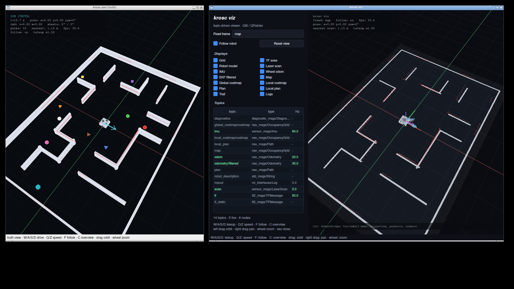

# krosc

`kros`(순수 파이썬 ROS 클론)를 C++20으로 다시 만든 것. 목표는 같다: **ROS와 같은 이름/사용법**을 유지하면서,
파이썬 구현의 스레드/복사 비용을 없애 더 빠르고 예측 가능하게 만드는 것.

| 패키지 | 내용 |
|---|---|
| `core/` | ROS 프레임워크: Node, 토픽+QoS, TF, 타이머, 파라미터, 서비스, 메시지, URDF, 기본 노드, **TCP 원격 토픽(9000)** |
| `sim/` | **진실 시뮬레이션**: MazeWorld, TurtleBot3(슬립/잡음), SimulationRunner, Snapshot, **Qt SimWindow** |
| `viz/` | **토픽 뷰어**: rviz 스타일 Qt 화면 (TF, map, costmap, scan, odom/filtered, 경로, 로그, 패널, teleop, **URDF visual STL 메시**) + **원격 `--server` 모드** |
| `examples/turtlebot3/` | sim + viz + EKF를 한 프로세스에서 같이 돌리는 데모 (`--server`로 원격 viz 테스트 가능) |
| `../krosc_ws/` | **실기 Pi 워크스페이스**: OpenCR/LDS-03 C++ 드라이버, EKF, 원격 viz 서버 (`krosc`를 링크) |



*왼쪽 `SimWindow`(진실), 오른쪽 `VizWindow`(토픽). 이 화면은 Docker의 Ubuntu 26.04 안에서 두 Qt 창을 띄우고,
맥 브라우저(noVNC)로 그대로 본 것이다.*

원격 모드 검증 (같은 TCP 경로, 로컬 서버 + 원격 viz): `docs/remote-viz.png`  
실기 C++ vs Python 성능 비교: [`docs/performance-vs-python.md`](docs/performance-vs-python.md)

## 맥에서 UI 보기 (Docker + noVNC)

Docker Desktop(macOS)에는 X 서버가 없다. 그래서 컨테이너 안에서 **Xvfb(가상 디스플레이) + openbox + x11vnc + noVNC**를
띄우고, 맥 브라우저가 그 리눅스 데스크톱을 WebSocket으로 본다.

```bash
cd /Users/hyunhakim/workspace/visualkhh/source/ros2

./docker/build.sh          # Ubuntu 26.04 + GCC + CMake + Qt6 + noVNC (처음 한 번)
./docker/vnc.sh            # 컨테이너 안에서 sim + viz 두 창을 띄운다
```

브라우저에서:

```
http://localhost:6080/vnc.html?autoconnect=1&resize=scale
```

- sim/viz/데이터는 **전부 컨테이너의 리눅스 안**에서 돈다. 맥은 화면(WebSocket 6080)만 본다.
- 왼쪽 `krosc sim (truth)` 창에서 `W/A/S/D`로 직접 로봇을 몰 수 있고, 오른쪽 `krosc viz` 창에서도 조종할 수 있다.
- `Ctrl+C`로 `docker/vnc.sh`를 끝내면 컨테이너도 정리된다.
- noVNC는 로컬 개발용으로 **비밀번호 없이**(`-nopw`) 띄운다. `6080`을 외부에 공개하지 마라.

`docker/README.md`에 같은 내용과 XQuartz 대안이 있다.

## 빌드/테스트 (Docker, 화면 없이)

```bash
cd /Users/hyunhakim/workspace/visualkhh/source/ros2
./docker/build.sh
./docker/compile.sh RelWithDebInfo --clean
```

`docker/compile.sh`는 `ros2/` 전체를 컨테이너 `/workspace`에 마운트하고 `/workspace/krosc`에서
GCC + CMake + Ninja로 빌드한 뒤 `ctest`를 돌린다.

```bash
# 오프스크린 스크린샷 (Docker, GUI 없이)
docker compose -f docker/docker-compose.yml run --rm krosc bash -lc \
  "QT_QPA_PLATFORM=offscreen ./build/examples/turtlebot3/krosc_turtlebot3 \
   --screenshot /workspace/krosc/docs/screenshot.png \
   --screenshot-sim /workspace/krosc/docs/simulation.png \
   --duration 4 --headless"
```

## 로컬 GUI (macOS/Linux, Qt6 설치된 경우)

```bash
cd krosc
cmake -S . -B build -DCMAKE_BUILD_TYPE=RelWithDebInfo
cmake --build build -j
./build/examples/turtlebot3/krosc_turtlebot3
```

`SimWindow`(진실)와 `VizWindow`(토픽) 두 창이 같이 뜬다. Docker 없이 바로 조종할 때 이 방법을 쓴다.

## 데모

```
MazeWorld(진실) ─ TurtleBot3(바퀴 슬립/IMU 잡음/라이다 잡음, seed 고정)
        │ tick 60Hz
        ├─ RobotBridge: scan/imu/joint_states 발행, cmd_vel 수신
        ├─ DiffDriveOdometry: joint_states -> odom (TF는 끔)
        ├─ Ekf: odom(vx, vyaw) + imu(vyaw) -> odometry/filtered + odom -> base_footprint TF
        ├─ RobotStatePublisher: URDF -> robot_description/tf_static/관절 tf
        ├─ MapPublisher: MazeWorld 벽 -> map(latch), map -> odom 정적 TF
        ├─ SnapshotRecorder: 진실 상태(로봇/퍽/라이다)를 불변 스냅샷으로 -> SimWindow
        ├─ SimWindow: 월드/로봇/퍽/진실 라이다를 3D 투영으로 그린다 (QPainter)
        └─ VizWindow: tf/tf_static, robot_description, map, scan, odom, filtered, 로그를 구독해 그린다
```

두 화면의 차이가 핵심이다: `SimWindow`는 **진실**(시뮬레이션 내부), `VizWindow`는 **로봇이 토픽으로 내보낸 추정**을 보여 준다.

| 입력 | 동작 |
|---|---|
| `W/A/S/D` 또는 방향키 | 조종 (sim 창은 로봇 직접, viz 창은 `cmd_vel` 발행) |
| `Q` / `Z` | 조종 속도 ×1.25 / ÷1.25 |
| `F` | 로봇 추적 on/off |
| `C` / `R` | 카메라 초기화 |
| 왼쪽 드래그 | 궤도 회전 |
| 오른쪽 드래그 | 평행 이동 |
| 휠 | 줌 |
| `Esc` | 창 닫기 |

## 구조

```
krosc/
├── CMakeLists.txt                 # 최상위 (engine, sim, viz, examples)
├── engine/                        # krosc_core (표준 라이브러리만)
│   ├── CMakeLists.txt
│   ├── include/krosc/             # node/context/topic/timer/tf/parameter/service/msgs/urdf/log
│   │   └── nodes/                 # DiffDriveOdometry, Ekf, RobotStatePublisher, TfEcho, TwistMux
│   ├── core/                      # 라이브러리 소스
│   ├── tests/                     # core 29 tests (net 포함)
│   └── benchmarks/bench.cpp
├── sim/                           # krosc_sim (+ krosc_sim_qt)
│   ├── CMakeLists.txt
│   ├── include/krosc/sim/         # world, maze_world, turtlebot3, runner, snapshot, view_window
│   ├── core/                      # 라이브러리 소스
│   └── tests/                     # sim 3 tests
├── viz/                           # krosc_viz (Qt6 Widgets)
│   ├── CMakeLists.txt
│   ├── main.cpp                   # krosc_viz_app
│   ├── include/krosc/viz/         # VizModel, SceneView, VizWindow, plugin API
│   ├── core/                      # Viz shell/렌더 소스
│   └── plugins/                   # 코어 Viz 플러그인
├── examples/turtlebot3/           # krosc_turtlebot3
└── docs/                          # 검증 스크린샷 (vnc.png, screenshot.png, simulation.png)
```

Docker 설정은 저장소 루트의 `../docker/`에 있다.

### 의존성

- `core`: C++20 표준 라이브러리 + pthread (Eigen/numpy 없음)
- `sim`: `core`의 메시지 타입 + pthread. **Qt가 없어도 물리/테스트는 빌드된다.**
- `sim_qt`: `sim` + Qt6 Widgets (`SimWindow`)
- `viz`: `core` + Qt6 Widgets (`VizWindow`)
- `examples`: `core` + `sim_qt` + `viz`

## API 맛보기

### 노드, 토픽, 타이머, 파라미터

```cpp
#include "krosc/krosc.hpp"

class Talker : public krosc::Node {
 public:
  Talker(krosc::Context& context) : Node(context, "Talker") {
    rate_ = declare_parameter<double>("rate", 10.0, [](double hz) { return hz > 0.0; });
    timer_ = create_timer(1.0 / rate_.value(), [this] {
      krosc::msgs::String message;
      message.data = "hello " + std::to_string(count_++);
      publish("chatter", std::move(message));
    });
  }

 private:
  krosc::Parameter<double> rate_;
  krosc::Timer timer_;
  int count_ = 0;
};
```

### TF

```cpp
krosc::Buffer buffer;
krosc::TransformListener listener(buffer, node);

krosc::msgs::TransformStamped tf;
tf.header.stamp = node.now();
tf.header.frame_id = "odom";
tf.child_frame_id = "base_footprint";
tf.transform.translation = {x, y, 0.0};
tf.transform.rotation = krosc::tfmath::from_yaw(yaw);
broadcaster.send_transform(tf);

const auto result = buffer.lookup_transform("map", "base_scan");
```

### 서비스

```cpp
auto server = node.create_service<krosc::msgs::SetBoolRequest, krosc::msgs::SetBoolResponse>(
    "enable", [](const auto& request) {
      return krosc::msgs::SetBoolResponse{request.data, "ok"};
    });
const auto response = node.call_service<krosc::msgs::SetBoolRequest, krosc::msgs::SetBoolResponse>(
    "enable", {true});
```

### 시뮬레이션 + 진실 화면

```cpp
krosc::sim::MazeWorld world(10, 42);
auto robot_holder = std::make_unique<krosc::sim::TurtleBot3>(/*noisy=*/true, 42);
auto* robot = static_cast<krosc::sim::TurtleBot3*>(world.add(std::move(robot_holder)));

krosc::sim::SnapshotRecorder recorder(world, *robot);
krosc::sim::SimWindow sim_window(world.walls(), *robot, recorder.store());
sim_window.show();

krosc::sim::SimulationRunner runner(world, 60.0);
runner.add_listener([&](krosc::sim::World& current) {
  time_source->set(current.time());
  recorder.record();
});
runner.start();
```

## 최적화 포인트

1. **메시지 복사 제거** — 발행은 `std::shared_ptr<const T>` 하나를 구독자 큐에 넣는다.
2. **구독 목록 스냅샷** — 발행마다 구독자 vector를 복사하지 않는다 (구독/해제 때만 copy-on-write).
3. **스레드 하나/구독 하나 제거** — 기본 inline 실행기(결정적), 실시간은 공용 워커 풀. 구독 하나는 drain 작업 하나로 순서 유지.
4. **타이머 스레드 하나** — 실제 시간은 스케줄 스레드 1개, 시뮬레이션 시간은 `set()`을 부른 스레드가 즉시 판정.
5. **컴파일 타임 타입** — 토픽 타입은 C++ 템플릿으로 고정. 런타임 타입 검사/딕셔너리 룩업 없음.
6. **TF 이력** — 좌표계별 정렬 vector + `lower_bound` 보간, 조건 변수 timeout.
7. **라이다** — AABB slab 교차를 C++로 직접 계산 (360광선 x 20벽 ~60–70µs).
8. **스냅샷 경계** — 시뮬레이션 스레드는 `SnapshotStore`에 불변 스냅샷만 넣고, Qt 스레드는 그것만 읽는다 (락 경합 최소).

측정값 (`./build/engine/krosc_bench`, Ubuntu 26.04 컨테이너, 대략값):

```
pub/sub inline      :   ~200 ns/op   (콜백 포함, 100만 회)
pub/sub pool(4)     :   ~400 ns/op   (워커 4개, 20만 회 모두 전달)
tf lookup           :   ~0.6 us/op   (300개 이력, 보간)
lidar 360 rays      :  60-70 us/scan (20개 벽)
```

## 테스트

```bash
ctest --test-dir build --output-on-failure
# core 28 + sim 3 = 31 tests, 2 executables
```

- core: 토픽/타입 잠금/latch/depth, 실행기, 타이머(시뮬/실시간), 파라미터, TF(보간/순환/timeout), URDF, 서비스, RSP, odometry, twist_mux
- sim: 레이/직진, scan/imu/odom/filtered 발행 + EKF, SimulationRunner
- ASan/UBSan으로 core/sim 테스트와 데모 실행 검증 완료 (오류/누수 없음)

## 지금 된 것 / 다음

**된 것**

- [x] Node/Context/Krosc, 토픽 + QoS + latch, 실행기 (inline/thread pool)
- [x] 타이머 (실제/시뮬레이션 시간), 파라미터(+이벤트), 서비스
- [x] TF2 스타일 Buffer/Listener/Broadcaster, 변환 수학, 정적 TF
- [x] 메시지: TF, Odometry, LaserScan, Imu, JointState, OccupancyGrid, Path, DiagnosticArray, Log 등
- [x] URDF 파서 (링크/관절/visual/collision, xacro 인자 치환)
- [x] DiffDriveOdometry, Ekf, RobotStatePublisher, TfEcho, TwistMux
- [x] `sim` 패키지: MazeWorld, TurtleBot3(슬립/잡음), SimulationRunner, SnapshotRecorder
- [x] `sim` Qt `SimWindow`: 진실 월드/퍽/로봇/잡음 없는 라이다 (QPainter 3D)
- [x] `viz` Qt `VizWindow`: 격자, TF 축, URDF, 라이다, odom/filtered, map/costmap, 경로, 궤적, 로그, 패널, teleop
- [x] TCP 원격 토픽(9000): 텔레메트리 + `cmd_vel`, latched 다중 tf_static, Mac `krosc_viz_app --server`
- [x] noVNC: Docker Ubuntu 26.04 안의 sim+viz 두 창을 맥 브라우저로 본다
- [x] 오프스크린 스크린샷 검증 (`docs/`)
- [x] `../krosc_ws/`: OpenCR/LDS-03 C++ 드라이버 + EKF + 원격 viz를 붙인 실기 Pi용 워크스페이스 (하드웨어 실측은 Pi에서 해야 함)

**다음 후보** (파이썬 kros에 이미 있는 것)

- [ ] 액션 (`ActionServer`/`ActionClient`)
- [ ] `DiagnosticUpdater`/`DiagnosticAggregator`
- [ ] MapServer/MapSaver (yaml + pgm), Cartographer 스타일 SLAM
- [ ] nav2: costmap, planner, controller, bt_navigator
- [ ] 진짜 하드웨어: OpenCR 시리얼, LDS-03 시리얼
- [ ] 네트워크 심화: 파라미터/서비스/액션, 다중 클라이언트, 보안, rosbag 기록/재생
- [ ] viz: 2D Goal Pose/초기 자세 추정, 마우스로 지도 편집, STL 메시 렌더링
- [ ] `krosc_ws`: Cartographer SLAM, nav2/Smac/MPPI, collision_monitor, 지도 저장/불러오기

## 메모

- 기존 파이썬 `../kros/`와는 별개다. 이름만 `krosc`로 구분한다.
- noVNC는 로컬 개발용이다. 포트 6080을 밖에 열지 마라.
- `viz`는 **토픽만** 본다. 진실은 `sim`의 `SimWindow`가 그린다. 같은 화면에서 바퀴 오도메트리/EKF가 진실에서
  얼마나 벗어나는지 비교할 수 있다.
- `.cpp` 스타일은 ROS 2 C++와 비슷하게 맞췄다: `Node::create_timer`, `publish`, `subscribe`, `declare_parameter`,
  `lookup_transform`, `send_transform`.
