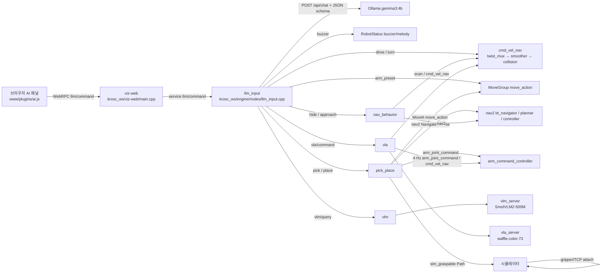

# AI 명령 처리 구조 (LLM / VLM / VLA / Manipulator)

> 결론부터: **LLM은 의도 파서·라우터다.** LLM이 모터 궤적을 만드는 게 아니다.
> 로봇팔 pick/place는 `pick_place` 노드가 **nav2(접근) + MoveIt(관절 궤적) + gripper 시퀀스**로 수행하고,
> 시뮬레이터가 그리퍼가 닫히는 순간 물체를 TCP에 붙인다.
> VLA는 별도의 학습 정책(4 Hz action chunk), VLM은 이미지 질의응답이다.

## 1. 전체 경로



### 계층

| 계층 | 위치 | 역할 |
|---|---|---|
| 프레임워크 | `krosc/engine` | Node/Service/Topic/Action, TF, URDF, Nav2/MoveIt 구현 |
| 프로젝트 엔진 | `krosc_ws/engine` | 하드웨어(OpenCR/LDS/RealSense) + AI/명령 노드 조립 |
| 시뮬레이터 | `krosc_ws/simulator`, `krosc/simulator` | 로봇/월드/센서/Qt 뷰/오디오 |
| 웹 | `krosc_ws/viz-web`, `krosc/viz-web` | WebSocket RPC, AI 패널, 토픽 표시 |
| 모델 sidecar | `krosc_ws/tools` | PyTorch/Transformers 모델을 HTTP로 감싼 프로세스 |

## 2. 서비스 이름 규칙 (krosc vs ROS 2)

krosc의 `Node::create_service(name, handler)`는 **이름을 그대로 전역 레지스트리**에 넣는다.
ROS 2처럼 namespace가 자동으로 붙지 않고, 노드 이름도 자동 prefix가 아니다.
ROS 2도 `~/service`만 노드 이름을 쓰고, 기본은 namespace 기준이다.

| 종류 | 예 | 비고 |
|---|---|---|
| 서브시스템 API | `llm/command`, `pick/command`, `nav/hide`, `vla/command`, `vlm/query` | 호출부/웹이 아는 논리 이름 |
| 노드 내부 | `controller_manager/switch_controller`, `move_group/scrub` | 노드가 이름에 직접 prefix |
| 레거시 flat | `buzzer`, `buzzer/melody`, `arm/stop` | `robot_status` 내부 |

일관성을 원하면 `buzzer` → `robot_status/buzzer`처럼 옮기고,
`Node::create_service`에 private prefix 옵션을 추가하면 된다. 지금은 기존 호출부를 깨지 않게 유지.

## 3. LLM intent → 도구 라우팅

`llm_input`의 JSON schema(`kSchema`)가 허용하는 intent와 실제 처리:

| intent | 파라미터 | 처리 | 서비스/토픽 |
|---|---|---|---|
| `drive` | `meters`, `direction=forward/backward` | `start_drive` | `cmd_vel_nav` |
| `drive` | `degrees`, `direction=left/right` | `start_turn` | `cmd_vel_nav` |
| `arm_preset` | `preset=home/stow` | MoveGroup preset | `move_action` |
| `buzzer` | `melody=mario_death/success/alarm/beep` | 멜로디 시퀀서 | `buzzer/melody` |
| `pick` | `target=색` | 접근+MoveIt pick | `pick/command` |
| `place` | - | 내려놓기 | `pick/command` |
| `hide` | - | 벽 뒤 free cell로 nav2 | `nav/hide` |
| `approach` | - | 라이다로 벽 앞 0.22 m | `nav/approach` |
| `vlm_query` | `question` | SmolVLM2 이미지 Q&A | `vlm/query` |
| `vla_pick` | `target` | 학습 VLA 4 Hz chunk | `vla/command` |
| `stop` | - | drive/arm/nav/VLA 정지 | `vla/stop`, `pick/stop`, `nav/stop` |
| `unsupported` | - | 거부 | - |

LLM은 **의도/파라미터만** 뽑고, 실행은 각 노드가 한다.
`meters`는 schema에서 필수이고, drive가 아니면 0으로 채운다.
"오른쪽으로 45도" 같은 문장을 모델이 `arm_preset`으로 오분류하는 경우가 있어
`apply_direction_hint()`가 좌/우/뒤/회전 문구를 결정적으로 `drive`로 보정한다.

## 4. 로봇팔은 어떻게 집는가 (요약)

1. `pick` intent → `pick/command` 서비스
2. `pick_place`가 `sim_graspable`(Path)에서 물체 중심 pose를 읽는다.
3. 물체가 0.42 m보다 멀면 **nav2**로 퍽 앞 0.34 m standoff까지 이동.
4. 0.42 m 이내면 로컬 접근(전진/회전, 3 s 정체 감지).
5. `controller_manager/switch_controller`로 `joint_trajectory_controller` 활성화(best-effort).
6. MoveIt `move_action` joint-space 시퀀스:
   - approach `z = center + 0.13`, pitch 20°, gripper 19 mm
   - descend `z = center + 0.015`, pitch 45°
   - close `grip = 8 mm` (4 cm 퍽, 그리퍼 최대 6.2 cm)
   - lift `z = center + 0.16`, pitch 20°
7. MoveIt 결과의 `error_code`까지 검사하고, 실패면 `pick/status`에 오류를 낸다.
8. 시뮬레이터 `WafflePiArm::update_grasp()`가 gripper ≤ 12 mm + TCP 5 cm 이내면
   물체를 held로 표시하고 TCP 기준 상대 pose로 운반한다. 열리면(>15 mm) 놓는다.

자세한 소스/예시는 [manipulator.md](manipulator.md).

## 5. 문서 목록

- [llm.md](llm.md) — Ollama schema, worker/status, 방향 보정, 라우팅
- [vlm.md](vlm.md) — vlm_node + SmolVLM2 sidecar, 이미지 Q&A
- [vla.md](vla.md) — vla_node 4 Hz chunk, waffle-color-73 sidecar, 주기/안전
- [manipulator.md](manipulator.md) — pick/place, nav2 접근, MoveIt, sim grasp
- [nav.md](nav.md) — drive/turn, wall approach, hide(costmap line-of-sight + nav2)
- [buzzer.md](buzzer.md) — OpenCR `B,Hz,ms`, 시뮬레이터 Qt 오디오

## 6. 실행 (Mac 시뮬레이터)

```bash
cd /Users/hyunhakim/workspace/visualkhh/source/ros2
./krosc_ws/run-mac.sh            # simulator:9000 + viz-web:8080
```

VLA/VLM sidecar:

```bash
krosc_ws/tools/vla-venv/bin/python krosc_ws/tools/vla_server.py --threads 6
krosc_ws/tools/vla-venv/bin/python krosc_ws/tools/vlm_server.py --device mps --threads 6
```

모델 위치:

```text
krosc_ws/artifacts/models/vla/waffle-hf-vla.pt      # SmolVLM2 기반 action head (parent)
krosc_ws/artifacts/models/vla/waffle-color-73.npz   # color trajectory head
krosc_ws/artifacts/models/vla/hf-cache/             # SmolVLM2 weights (VLA)
krosc_ws/artifacts/models/vlm/hf-cache/             # SmolVLM2 weights (VLM)
krosc_ws/tools/learning/                            # policy.py / color_imitation.py / actions.py
```

## 7. 현재 한계 (문서 기준일)

- 12 cm 대형 퍽은 4 cm 그리퍼로 못 잡는다. 잡을 수 있는 **4 cm × 12 cm 노란 퍽**을 따로 추가했다.
- 시뮬레이터 grasp는 **kinematic attach**다. 실제 물리 마찰/미끄러짐은 아니다.
- nav2 hide/pick 접근은 **map + localization**이 필요하다. `slam: idle` + 지도 없음이면 거부된다.
- VLA `waffle-color-73`은 **red/blue 전용**이고, 학습은 Isaac 로봇 D435 뷰다.
  krosc 시뮬 D435와 도메인이 달라 plan이 이상할 수 있다. "노란색 퍽"은 `pick`(결정적)으로 간다.
- VLA sidecar는 500M CPU/MPS 추론이라 실시간 10 Hz는 아니다. chunk 큐로 주기를 지킨다.
- `dance`/일반 `navigate`(이름/빈 칸 지정) intent는 아직 없다.
