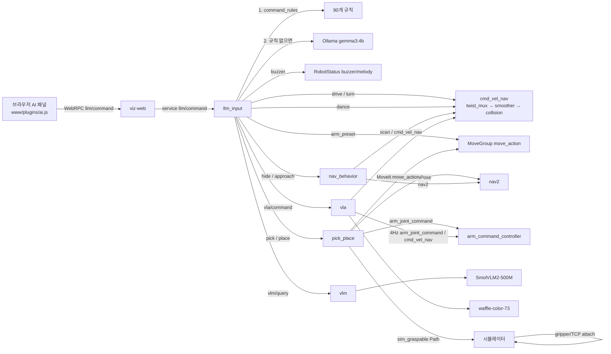

# AI 명령 처리 구조 (LLM / VLM / VLA / Manipulator)

> **한 문장**: LLM은 "무슨 일을 할지"만 정하고, 실제 모터/팔/주행은
> `pick_place`, `nav_behavior`, `vla_node`, `robot_status`가 결정적으로 실행한다.
> 자주 쓰는 90개 명령은 LLM 없이 `command_rules`가 먼저 잡는다.

## 0. 3분 따라가기 — "노란 퍽을 집어 올려"

```text
① 브라우저 AI 패널
   "앞에 있는 노란색 퍽을 집어 올려"
        │  WebRPC llm/command
        ▼
② llm_input
   command_rules 매칭
   {"intent":"pick","target":"yellow"}
        │  service pick/command
        ▼
③ pick_place
   sim_graspable(Path)에서 퍽 중심 (0.28, 0)
   거리 > 0.80m? → nav2 NavigateToPose(standoff 0.34m)
   거리 ≤ 0.80m? → 로컬 전진/회전
        │  MoveIt move_action
        ▼
④ MoveGroup
   approach(z=center+0.13, pitch 20°, grip 19mm)
   descend (z=center+0.015, pitch 45°)
   close   (grip 8mm)
   lift    (z=center+0.16, pitch 20°)
        │
        ▼
⑤ 시뮬레이터 WafflePiArm
   gripper ≤ 12mm + TCP 5cm 이내 → 물체를 held로 attach
   pick/status: approach → descend → close → lift → done
```

중간 상태는 전부 `llm/status`, `pick/status`로 나가고 AI 패널의
`llm`, `plan`, `action` 줄에 표시된다.

## 1. 왜 이렇게 나눴나

| 선택 | 이유 |
|---|---|
| LLM은 라우터만 | 4B 모델이 관절 궤적을 만들면 재현이 안 된다. 의도/파라미터만 뽑는다. |
| 90개 규칙 우선 | 자주 쓰는 명령은 네트워크/모델 없이 즉시, 같은 결과로 동작해야 한다. |
| pick/place 분리 | 집기는 접근+파지, 놓기는 위치 결정+해제로 실패 지점이 다르다. |
| floor/body는 place target | "바닥/내 몸"은 같은 놓기 계획의 목적지 차이다. |
| VLA는 별도 노드 | 학습 정책은 4Hz chunk/큐/안전을 C++가 소유하고, Python은 forward만 한다. |
| VLM은 질의만 | 이미지 설명을 제어 루프에 넣으면 재현이 안 된다. |

## 2. 전체 경로



### 계층

| 계층 | 위치 | 역할 |
|---|---|---|
| 프레임워크 | `krosc/engine` | Node/Service/Topic/Action, TF, URDF, Nav2/MoveIt |
| 프로젝트 엔진 | `krosc_ws/engine` | 하드웨어 + AI/명령 노드 조립 |
| 시뮬레이터 | `krosc_ws/simulator`, `krosc/simulator` | 로봇/월드/센서/Qt 뷰/오디오 |
| 웹 | `krosc_ws/viz-web`, `krosc/viz-web` | WebSocket RPC, AI 패널, 토픽 표시 |
| 모델 sidecar | `krosc_ws/tools` | PyTorch/Transformers를 HTTP로 감싼 프로세스 |

## 3. 명령 카탈로그 (20 + 20 + 30 + 20)

| 카테고리 | 대표 명령 | plan | 문서 |
|---|---|---|---|
| 매니퓰레이터 | `앞에 있는 노란색 퍽을 집어 올려` | `pick target=yellow` | [commands.md](commands.md#1-매니퓰레이터-20) |
| | `내 몸에 올려놔` | `place target=body` | |
| | `팔 접어` | `arm_preset stow` | |
| 주행 | `앞으로 1m` | `drive forward 1.0m` | [commands.md](commands.md#2-주행-20) |
| | `왼쪽으로 90도` | `drive left 90°` | |
| | `멈춰` | `stop` | |
| 엔터테인먼트 | `춤춰` | `dance style=dance` | [commands.md](commands.md#3-엔터테인먼트-30) |
| | `빙글빙글 돌아` | `dance style=spin` | |
| | `인사해` | `dance style=bow` | |
| | `노래부르면서 춤춰` | `dance style=show` | |
| | `손 흔들어` | `dance style=wave` | |
| 비프음 | `마리오 죽을 때 효과음` | `buzzer mario_death` | [commands.md](commands.md#4-비프음-20) |
| | `성공음` | `buzzer success` | |
| | `삐 소리` | `buzzer beep` | |

전체 90개는 [commands.md](commands.md)에 표로 정리되어 있다.

## 4. LLM intent → 도구 라우팅

| intent | 파라미터 | 처리 | 서비스/토픽 |
|---|---|---|---|
| `drive` | `meters`, `direction=forward/backward` | `start_drive` | `cmd_vel_nav` |
| `drive` | `degrees`, `direction=left/right` | `start_turn` | `cmd_vel_nav` |
| `dance` | `style=dance/spin/wiggle/bow/celebrate/show/wave` | 100ms 패턴 (+ show/wave는 arm_joint_command) | `cmd_vel_nav`, `arm_joint_command` |
| `arm_preset` | `preset=home/stow` | MoveGroup preset | `move_action` |
| `buzzer` | `melody=mario_death/success/alarm/beep` | 멜로디 시퀀서 | `buzzer/melody` |
| `pick` | `target=색` | 접근+MoveIt pick | `pick/command` |
| `place` | `target=floor/body` | 내려놓기 | `pick/command` |
| `hide` | - | 벽 뒤 free cell로 nav2 | `nav/hide` |
| `approach` | - | 라이다로 벽 앞 0.28m | `nav/approach` |
| `vlm_query` | `question` | SmolVLM2 이미지 Q&A | `vlm/query` |
| `vla_pick` | `target` | 학습 VLA 4Hz chunk | `vla/command` |
| `stop` | - | drive/arm/nav/VLA 정지 | `vla/stop`, `pick/stop`, `nav/stop` |
| `unsupported` | - | 거부 | - |

- `meters`는 schema에서 필수다. drive가 아니면 0.
- 90개 규칙에 없는 문장만 Ollama로 간다. `llm/status`의 `source`가 `rule`/`llm`을 알려준다.
- LLM이 좌/우/뒤/회전을 오분류하면 `apply_direction_hint()`가 결정적으로 보정한다.

## 5. 서비스 이름 규칙 (krosc vs ROS 2)

krosc의 `Node::create_service(name, handler)`는 **이름을 그대로 전역 레지스트리**에 넣는다.
ROS 2처럼 namespace가 자동으로 붙지 않고, 노드 이름도 자동 prefix가 아니다.
(ROS 2도 기본은 namespace 기준이고 `~/service`만 노드 이름을 쓴다.)

| 종류 | 예 | 비고 |
|---|---|---|
| 서브시스템 API | `llm/command`, `pick/command`, `nav/hide`, `vla/command`, `vlm/query` | 호출부/웹이 아는 논리 이름 |
| 노드 내부 | `controller_manager/switch_controller`, `move_group/scrub` | 노드가 이름에 직접 prefix |
| 레거시 flat | `buzzer`, `buzzer/melody`, `arm/stop` | `robot_status` 내부 |

일관성을 원하면 `buzzer` → `robot_status/buzzer`처럼 옮기고,
`Node::create_service`에 private prefix 옵션을 추가하면 된다. 지금은 기존 호출부를 깨지 않게 유지.

## 6. 로봇팔은 어떻게 집는가 (요약)

1. `pick` → `pick/command` → `pick_place` 워커.
2. `sim_graspable`(Path)에서 퍽 중심 pose를 읽는다.
3. 0.80m보다 멀면 **nav2**로 퍽 앞 0.34m standoff까지 이동.
4. 0.80m 이내면 로컬 접근(전진/회전, 3초 정체 감지).
5. `controller_manager/switch_controller`로 `joint_trajectory_controller` 활성화(best-effort).
6. MoveIt `move_action` joint-space 시퀀스:
   - approach `z = center + 0.13`, pitch 20°, gripper 19mm
   - descend `z = center + 0.015`, pitch 45°
   - close `grip = 8mm` (4cm 퍽, 그리퍼 최대 6.2cm)
   - lift `z = center + 0.16`, pitch 20°
7. MoveIt 결과의 `error_code`까지 검사하고, 실패면 `pick/status`에 오류를 낸다.
8. 시뮬레이터가 gripper ≤12mm + TCP 5cm 이내면 물체를 held로 붙인다.
   열리면(>15mm) 놓는다. 상판 위면 `on_robot` payload로 로봇과 함께 움직인다.

자세한 소스/예시는 [manipulator.md](manipulator.md).

## 7. 문서 목록

- [commands.md](commands.md) — **90개 자연어 명령** (매니퓰레이터 20 / 주행 20 / 엔터 30 / 비프 20)
- [llm.md](llm.md) — 규칙 우선 파서, Ollama schema, worker/status, 라우팅
- [vlm.md](vlm.md) — `vlm_node` + SmolVLM2 sidecar, 이미지 Q&A
- [vla.md](vla.md) — `vla_node` 4Hz chunk, waffle-color-73 sidecar
- [manipulator.md](manipulator.md) — pick/place, nav2 접근, MoveIt, sim grasp
- [nav.md](nav.md) — drive/turn, wall approach, hide(costmap + nav2)
- [buzzer.md](buzzer.md) — OpenCR `B,Hz,ms`, 멜로디, 시뮬 Qt 오디오
- [simulator.md](simulator.md) — Alt+드래그, 높이, D435 자기 몸체 제외

## 8. 실행 (Mac 시뮬레이터)

```bash
cd /Users/hyunhakim/workspace/visualkhh/source/ros2
./krosc_ws/run-mac.sh            # simulator:9000 + viz-web:8080
```

VLA/VLM sidecar:

```bash
krosc_ws/tools/vla-venv/bin/python krosc_ws/tools/vla_server.py --threads 6
krosc_ws/tools/vla-venv/bin/python krosc_ws/tools/vlm_server.py --device mps --threads 6
```

모델 위치:

```text
krosc_ws/artifacts/models/vla/waffle-hf-vla.pt      # SmolVLM2 기반 action head (parent)
krosc_ws/artifacts/models/vla/waffle-color-73.npz   # color trajectory head
krosc_ws/artifacts/models/vla/hf-cache/             # SmolVLM2 weights (VLA)
krosc_ws/artifacts/models/vlm/hf-cache/             # SmolVLM2 weights (VLM)
krosc_ws/tools/learning/                            # policy.py / color_imitation.py / actions.py
```

## 9. 테스트

```bash
./krosc_ws/run-tests.sh
# core 60 + sim 5 + ws 24 (90개 명령 포함) 전부 통과

KROSC_TEST_FILTER=commands_ ./krosc_ws/build-mac/krosc_ws_tests
# commands_manipulator_20 / driving_20 / entertainment_30 / beep_20
```

실제 확인:

```text
웹 AI 패널
  "앞으로 1m"          → plan.source=rule, drive done
  "춤춰"               → dancing → done
  "성공음"             → buzzer success
  "내 몸에 올려놔"      → pick/status body_* → done
```

## 10. 현재 한계

- 12cm 대형 퍽은 4cm 그리퍼로 못 잡는다. 잡을 수 있는 **4cm × 12cm 노란 퍽**을 따로 추가했다.
- 실기 pick은 D435 color/depth detector(`grasp_info`의 width)로 그리퍼 close를 맞춘다.
  물체가 최대 개방(약 6.2cm)보다 크면 거부한다. 검출은 red/yellow/blue만 지원한다.
- 시뮬레이터 grasp는 **kinematic attach**다. 실제 물리 마찰/미끄러짐은 아니다.
- nav2 hide/pick 접근은 **map + localization**이 필요하다. 지도가 실제 월드와 어긋나면
  nav2가 replan만 반복할 수 있다(90초 후 에러).
- VLA `waffle-color-73`은 **red/blue 전용**이고, 학습은 Isaac 로봇 D435 뷰다.
  krosc 시뮬 D435와 도메인이 달라 plan이 이상할 수 있다. 노란 퍽은 `pick`(결정적)으로 간다.
- VLA sidecar는 500M CPU/MPS 추론이라 실시간 10Hz는 아니다. chunk 큐로 주기를 지킨다.
- `dance`는 2~8초 동안 명령 큐를 점유한다. `정지`로 즉시 취소할 수 있다.
