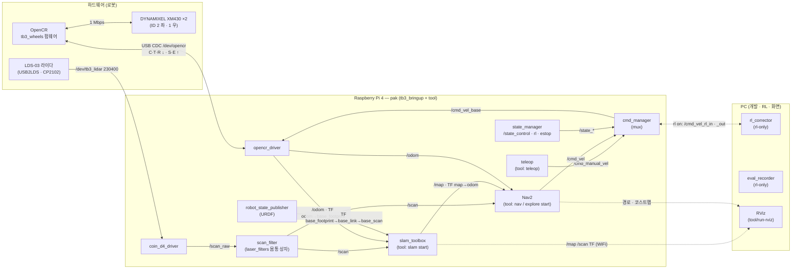
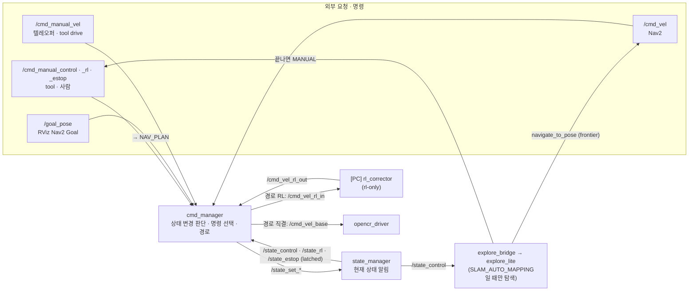
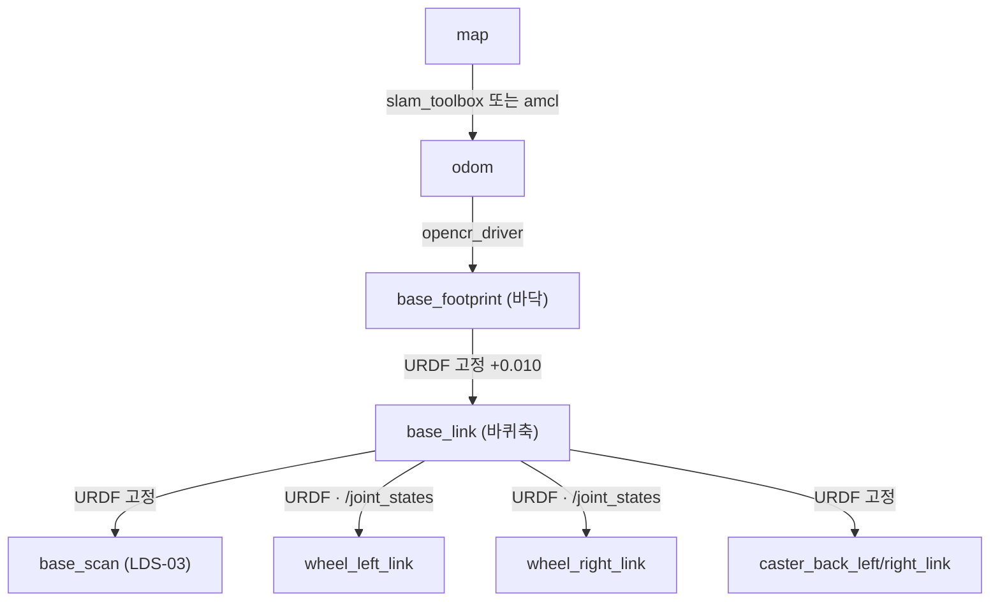

# 시스템 구성 (노드 계통도)

로봇 = TurtleBot3 Waffle Pi 개조형 (맨 위 판 제거, LDS-03 라이다 1층 앞).
**Pi(`pak`)는 움직이는 것**(드라이버·라이다·SLAM·Nav), **PC는 RL 계산·화면**. 둘은 같은 WiFi + `ROS_DOMAIN_ID=25`로 토픽을 주고받습니다
(WiFi가 멀티캐스트를 버려서 PC 쪽은 `tool/peers.sh`가 Pi를 유니캐스트로 찾음). 조작(`tool/run-cli`)은 토픽이 보이는 곳 어디서나.

- 사용법: [README.md](README.md) · 운영 도구: [../tool/README.md](../tool/README.md) · 펌웨어 프로토콜: [../firmware/opencr/README.md](../firmware/opencr/README.md)

## 1. 어디서 무엇이 도나

## 2. 운행 상태 · 바퀴 명령 경로 — cmd_manager · state_manager

- **cmd_manager** = 명령 처리. 외부 요청(`/cmd_manual_*`, RViz `/goal_pose`)을 받아 **운행 상태를 바꾸고**,
  상태대로 바퀴 명령을 **고르고(선택)** **경로를 정한다**(직결 / PC RL 경유). (ROS의 `twist_mux`는 우선순위로 고르기만 해서
  제어 상태·RL 경로는 못 함 → 직접 구현)
- **state_manager** = 현재 상태를 들고 `/state_*`(latched)로 알린다. 바꾸는 판단은 하지 않음 (cmd_manager가 `/state_set_*`로 기록).
- 상태 바꾸기 실전 정리(토픽·명령·메뉴·예시): [STATE_CONTROL.md](STATE_CONTROL.md)

| 상태 (`/state_*`) | 값 | 바꾸는 법 | 효과 |
|---|---|---|---|
| **제어 상태** — 바퀴를 누가 움직이나 | | | |
| 제어 상태 `/state_control` | `MANUAL` | `/cmd_manual_control MANUAL` · tool 텔레오퍼/drive (아니면 **물어봄**) | **수동** `/cmd_manual_vel`만 바퀴로 |
| | `NAV_PLAN` | `/cmd_manual_control NAV_PLAN` · tool goal · RViz Nav2 Goal | Nav2 `/cmd_vel`만 바퀴로 (목표 주행) |
| | `SLAM_AUTO_MAPPING` | `./run-cli automap start` (SLAM·SLAM 중 Nav 켜고 바꿈) | Nav2 `/cmd_vel`만 · explore_lite가 frontier 목표를 계속 보냄 · 다 찾으면 explore_bridge가 MANUAL로 |
| 경로 `/state_rl` | false = 직결 · true = RL 경유 | `/cmd_manual_rl` · `./run-cli route direct/rl` · `tb-only.launch.py rl:=true` | RL 경유면 `/cmd_vel_rl_in` → PC → `/cmd_vel_rl_out` |
| 비상정지 `/state_estop` | | `/cmd_manual_estop` · `./run-cli estop on/off` | true면 항상 0 (요청 즉시 0도 보냄) |
| **운행 상태** `/state_operation` | `SLAM` · `LOCALIZATION` · `IDLE` | state_manager가 떠 있는 노드로 판단 (slam_toolbox / amcl·map_server / 없음) | 위치를 어떻게 아나 — 맵핑 중인가, 지도로 위치 추정 중인가 |
| 지도 `/state_map` | `office` · `(SLAM 작성 중)` · `''` | state_manager가 map_server `yaml_filename`에서 | 지금 적용된 지도 |

안전: 고른 입력이 0.5초 넘게 끊기면 0, RL 경유인데 `/cmd_vel_rl_out`이 0.3초 넘게 끊기면(PC 꺼짐·WiFi) 0.
cmd_manager는 20 Hz로 계속 보내고, 드라이버(0.5초)와 펌웨어(500 ms watchdog)도 각자 멈춥니다.
모드를 바꾸면 이전 모드에서 온 수동 명령은 버립니다 (새 모드로 새지 않게).

| launch | 어디서 | 띄우는 것 |
|---|---|---|
| `tb-only.launch.py` | Pi | state_manager · cmd_manager · opencr_driver · robot_state_publisher · coin_d4_driver · scan_filter · scan_resample. RL 노드는 없음 — RL off로 시작 (`rl:=true`면 on으로) |
| `explore-nav.launch.py` | Pi | SLAM 중 Nav — Nav2 `navigation_launch.py` + lifecycle_manager (Lyrical은 manager가 `bringup_launch.py`에만 있음) + **explore_lite**(frontier 탐색, deps.repos) + **explore_bridge**(제어 상태 ↔ `/explore/resume`). `run-cli explore start`·자동 맵핑이 씀 |
| `rl-only.launch.py` | PC | rl_corrector(`/cmd_vel_rl_in` → `/cmd_vel_rl_out`) · eval_recorder — 로봇 노드는 안 띄움 |

`nav2_rl_controller`(Nav2 내부 `cmd_vel_nav` 단계 보정)는 패키지만 있고 아직 launch에 연결 안 함.

## 3. TF 트리 (REP-105)

| 프레임 | 누가 냄 | 기준으로 쓰는 곳 |
|---|---|---|
| `map → odom` | slam_toolbox(맵핑) · amcl(지도 주행) | Nav2 global costmap |
| `odom → base_footprint` | opencr_driver | SLAM `base_frame` · amcl `base_frame_id` |
| `base_footprint → base_link → …` | robot_state_publisher (`urdf/robot.urdf.xacro`) | Nav2 costmap · footprint 다각형 · 몸통 필터 |

## 4. 토픽

| 토픽 | 타입 | 내는 노드 | 받는 노드 |
|---|---|---|---|
| `/cmd_manual_vel` | Twist | tool teleop · drive | cmd_manager (MANUAL) |
| `/cmd_vel` | Twist | Nav2 (`enable_stamped_cmd_vel: false`) | cmd_manager (NAV_PLAN · SLAM_AUTO_MAPPING) |
| `/cmd_vel_base` | Twist | cmd_manager | opencr_driver |
| `/cmd_vel_rl_in` · `/cmd_vel_rl_out` | Twist | cmd_manager · rl_corrector (PC) | rl_corrector · cmd_manager · eval_recorder |
| `/cmd_manual_control` · `_rl` · `_estop` | String · Bool · Bool | tool · 사람 · explore_bridge(끝나면 MANUAL) | cmd_manager |
| `/state_set_control` · `_rl` · `_estop` | String · Bool · Bool | cmd_manager | state_manager |
| `/explore/resume` · `/explore/status` | Bool · ExploreStatus (latched) | explore_bridge · explore_lite | explore_lite · explore_bridge |
| `/explore_status` | String | explore_bridge (사람이 읽는 진행) | tool 상태바 |
| `/state_control` · `/state_rl` · `/state_estop` · `/state_operation` · `/state_map` | String · Bool · Bool · String · String (latched) | state_manager | cmd_manager · explore_bridge · tool |
| `/odom` | Odometry | opencr_driver | cartographer · Nav2 · eval_recorder · tool |
| `/joint_states` | JointState | opencr_driver (effort = 전류 A) | robot_state_publisher |
| `/diagnostics` | DiagnosticArray | opencr_driver (전류·온도·모터 에러) | tool · rqt |
| `/opencr/reboot` | Empty | 사람 · tool | opencr_driver → `R` |
| `/cmd_beep` | Empty | 사람 · tool (`run-cli beep` · 텔레오퍼 b) | cmd_manager → `/opencr/beep` → `B` (부저) |
| `/cmd_beep_tone` | Int32MultiArray `[Hz, ms]` | 사람 · tool (`beep <Hz> <ms>`) | cmd_manager → `/opencr/beep_tone` → `B,Hz,ms` |
| `/cmd_say` | String | 사람 · tool (텔레오퍼 t 타이핑삑) | cmd_manager (자모별 주파수로 변환·재생) → `/opencr/beep_tone` |
| `/scan_raw` | LaserScan | coin_d4_driver | scan_filter |
| `/scan_filtered` | LaserScan | scan_filter (몸통 가림 제거) | scan_resample |
| `/scan` | LaserScan | scan_resample (400칸 고정) | cartographer · amcl · Nav2 costmap |
| `/map` | OccupancyGrid | cartographer · map_server | Nav2 · RViz · tool map save |
| `/initialpose` · `/goal_pose` | Pose… | RViz · tool | amcl · Nav2 |

## 5. 장치 · 포트

| 장치 | USB | udev 이름 | 규칙 |
|---|---|---|---|
| OpenCR | `0483:5740` STM Virtual COM | `/dev/opencr` | `documents/raspberry/udev/99-opencr.rules` |
| LDS-03 (USB2LDS) | `10c4:ea60` CP2102 | `/dev/tb3_lidar` | `documents/raspberry/udev/99-tb3-lidar.rules` |

설치·설명: [documents/raspberry/udev-setup.md](../documents/raspberry/udev-setup.md).

## 6. 패키지

| 패키지 | 내용 |
|---|---|
| `tb3_bringup` | `state_manager` · `cmd_manager` · `opencr_driver` · `scan_resample` · `explore_bridge` · launch 4개 · `config/robot.yaml` · `config/lidar.yaml` · `config/explore.yaml` · URDF · 바퀴 메시 |
| `rl_correction` | `corrector` — `cmd_vel_in` → (ONNX 정책) → clip → `cmd_vel_out` |
| `nav2_rl_controller` | `controller_corrector` — Nav2 컨트롤러 출력 보정 (미연결) |
| `rl_eval` | `eval_recorder` — 보정 전/후 cmd·odom CSV · `benchmark_onnx.py` |
| `coin_d4_driver` (외부) | LDS-03 드라이버 — `deps.repos`(vcstool 소스 목록)로 받아 같이 빌드 (apt 없음, [README](README.md#depsrepos--apt에-없는-외부-소스)) |
| apt | slam_toolbox · nav2_bringup · laser_filters · robot_state_publisher · xacro |

SLAM·Nav2는 `ros2_ws` launch가 아니라 `tool/run-cli`가 켜고 끕니다 — 베이스(tb-only)는 켜 둔 채
맵핑 ↔ 지도 주행을 바꿔 켜기 때문. 프로세스는 항상 Pi에 뜨고(로봇이 아닌 곳에서 실행하면 tool이 SSH로 Pi에 넘김),
켜짐 여부는 노드 그래프로 봅니다. 설정은 `tool/config/slam_toolbox.yaml` · `nav2_params.yaml`.
