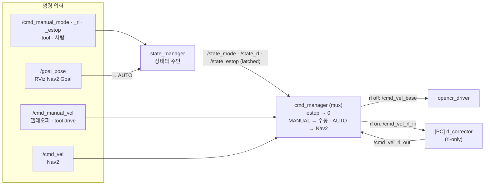
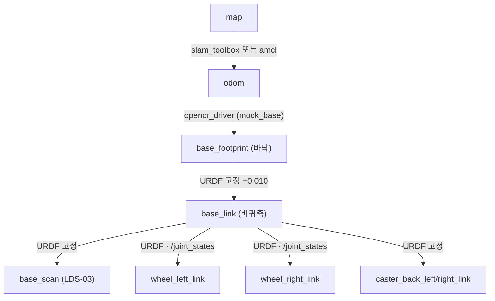

# 시스템 구성 (노드 계통도)

로봇 = TurtleBot3 Waffle Pi 개조형 (맨 위 판 제거, LDS-03 라이다 1층 앞).
**Pi(`pak`)는 움직이는 것**, **PC는 RL 계산·화면**. 둘은 같은 WiFi + `ROS_DOMAIN_ID=25`로 토픽을 주고받습니다.

- 사용법: [README.md](README.md) · 운영 도구: [../tool/README.md](../tool/README.md) · 펌웨어 프로토콜: [../firmware/opencr/README.md](../firmware/opencr/README.md)

## 1. 어디서 무엇이 도나

## 2. 바퀴 명령 경로 — state_manager · cmd_manager(mux)

명령은 모두 **cmd_manager**를 거쳐 드라이버로 갑니다. 무엇을 보낼지는 **state_manager**의 상태(`/state_*`)가 정합니다.
RL은 bringup을 바꾸지 않고 **실행 중에** `/cmd_manual_rl`로 켜고 끕니다.

| 상태 | 토픽 (latched) | 바꾸는 법 | 효과 |
|---|---|---|---|
| 모드 | `/state_mode` = `MANUAL` · `AUTO` | `/cmd_manual_mode` · tool 텔레오퍼/drive → MANUAL · tool goal/RViz Goal → AUTO | MANUAL이면 `/cmd_manual_vel`만, AUTO면 Nav2 `/cmd_vel`만 바퀴로 |
| RL | `/state_rl` = true/false | `/cmd_manual_rl` · `./run-cli rl on/off` · `tb-for-rl` = true로 시작 | true면 `/cmd_vel_rl_in` → PC → `/cmd_vel_rl_out`을 거침 |
| 비상정지 | `/state_estop` | `/cmd_manual_estop` · `./run-cli estop on/off` | true면 항상 0 |

안전: 고른 입력이 0.5초 넘게 끊기면 0, RL 켰는데 `/cmd_vel_rl_out`이 0.3초 넘게 끊기면(PC 꺼짐·WiFi) 0.
cmd_manager는 20 Hz로 계속 보내고, 드라이버(0.5초)와 펌웨어(500 ms watchdog)도 각자 멈춥니다.

| launch | 어디서 | 띄우는 것 |
|---|---|---|
| `tb-only.launch.py` | Pi | state_manager · cmd_manager · opencr_driver · robot_state_publisher · coin_d4_driver · scan_filter · scan_resample (RL off로 시작) |
| `tb-for-rl.launch.py` | Pi | tb-only를 **RL on으로 시작** (RL 노드는 안 띄움) |
| `rl-only.launch.py` | PC | rl_corrector(`/cmd_vel_rl_in` → `/cmd_vel_rl_out`) · eval_recorder — 로봇 노드는 안 띄움 |
| `basic_bringup.launch.py` | PC 시험 | state_manager · cmd_manager · mock_base (OpenCR 없이 같은 명령 경로) |

`nav2_rl_controller`(Nav2 내부 `cmd_vel_nav` 단계 보정)는 패키지만 있고 아직 launch에 연결 안 함.

## 3. TF 트리 (REP-105)

| 프레임 | 누가 냄 | 기준으로 쓰는 곳 |
|---|---|---|
| `map → odom` | slam_toolbox(맵핑) · amcl(지도 주행) | Nav2 global costmap |
| `odom → base_footprint` | opencr_driver (PC 시험: mock_base) | SLAM `base_frame` · amcl `base_frame_id` |
| `base_footprint → base_link → …` | robot_state_publisher (`urdf/robot.urdf.xacro`) | Nav2 costmap · footprint 다각형 · 몸통 필터 |

## 4. 토픽

| 토픽 | 타입 | 내는 노드 | 받는 노드 |
|---|---|---|---|
| `/cmd_manual_vel` | Twist | tool teleop · drive | cmd_manager (MANUAL) |
| `/cmd_vel` | Twist | Nav2 (`enable_stamped_cmd_vel: false`) | cmd_manager (AUTO) |
| `/cmd_vel_base` | Twist | cmd_manager | opencr_driver · mock_base |
| `/cmd_vel_rl_in` · `/cmd_vel_rl_out` | Twist | cmd_manager · rl_corrector (PC) | rl_corrector · cmd_manager · eval_recorder |
| `/cmd_manual_mode` · `_rl` · `_estop` | String · Bool · Bool | tool · 사람 | state_manager |
| `/state_mode` · `/state_rl` · `/state_estop` | String · Bool · Bool (latched) | state_manager | cmd_manager · tool |
| `/odom` | Odometry | opencr_driver | slam_toolbox · Nav2 · eval_recorder · tool |
| `/joint_states` | JointState | opencr_driver (effort = 전류 A) | robot_state_publisher |
| `/diagnostics` | DiagnosticArray | opencr_driver (전류·온도·모터 에러) | tool · rqt |
| `/opencr/reboot` | Empty | 사람 · tool | opencr_driver → `R` |
| `/scan_raw` | LaserScan | coin_d4_driver | scan_filter |
| `/scan` | LaserScan | scan_filter | slam_toolbox · amcl · Nav2 costmap |
| `/map` | OccupancyGrid | slam_toolbox · map_server | Nav2 · RViz · tool map save |
| `/initialpose` · `/goal_pose` | Pose… | RViz · tool | amcl · Nav2 |

## 5. 장치 · 포트

| 장치 | USB | udev 이름 | 규칙 |
|---|---|---|---|
| OpenCR | `0483:5740` STM Virtual COM | `/dev/opencr` | `documents/raspberry/udev/99-opencr.rules` |
| LDS-03 (USB2LDS) | `10c4:ea60` CP2102 | `/dev/tb3_lidar` | `documents/raspberry/udev/99-tb3-lidar.rules` |

설치·설명: [documents/raspberry/udev-setup.md](../documents/raspberry/udev-setup.md).

## 6. 패키지

| 패키지 | 내용 |
|---|---|
| `tb3_bringup` | `state_manager` · `cmd_manager` · `opencr_driver` · `scan_resample` · `mock_base` · launch 5개 · `config/robot.yaml` · `config/lidar.yaml` · URDF · 바퀴 메시 |
| `rl_correction` | `corrector` — `cmd_vel_in` → (ONNX 정책) → clip → `cmd_vel_out` |
| `nav2_rl_controller` | `controller_corrector` — Nav2 컨트롤러 출력 보정 (미연결) |
| `rl_eval` | `eval_recorder` — 보정 전/후 cmd·odom CSV · `benchmark_onnx.py` |
| `coin_d4_driver` (외부) | LDS-03 드라이버 — `deps.repos`로 받음 (apt 없음) |
| apt | slam_toolbox · nav2_bringup · laser_filters · robot_state_publisher · xacro |

SLAM·Nav2는 `ros2_ws` launch가 아니라 `tool/run-cli`가 켜고 끕니다 — 베이스(tb-only)는 켜 둔 채
맵핑 ↔ 지도 주행을 바꿔 켜기 때문. 설정은 `tool/config/slam_toolbox.yaml` · `nav2_params.yaml`.
