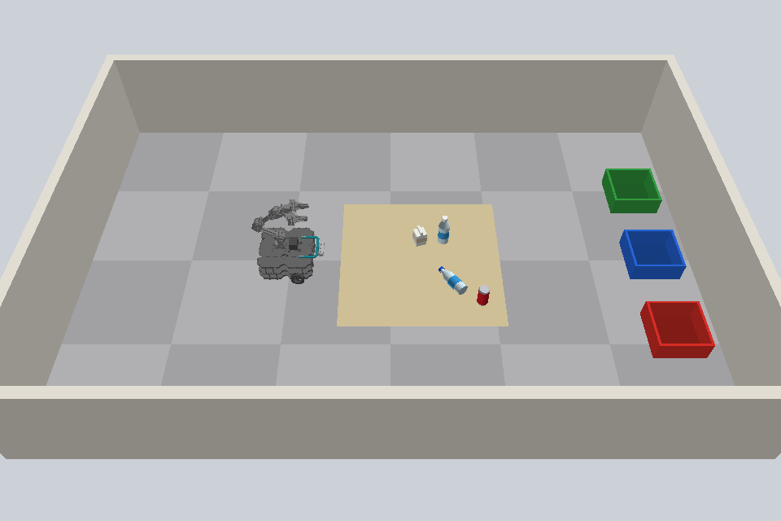
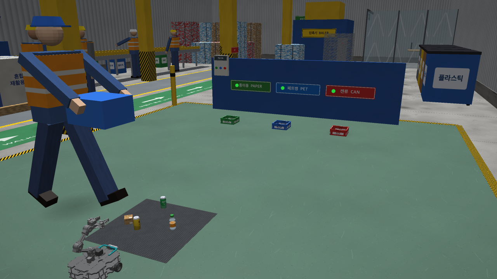
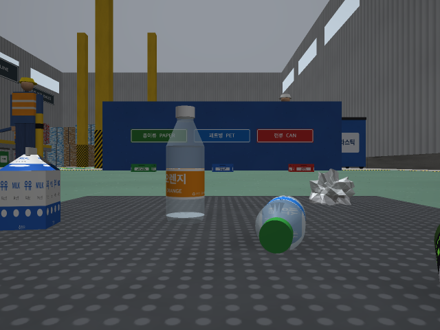
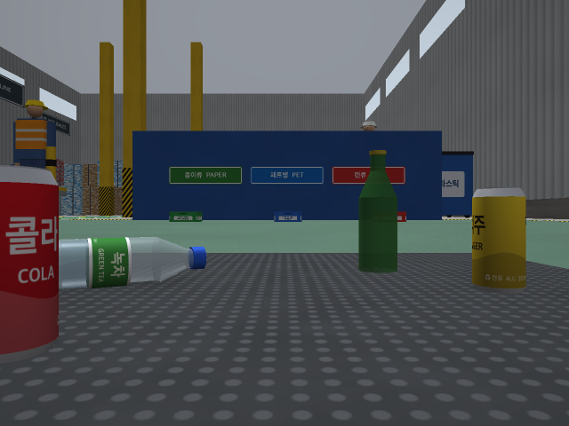
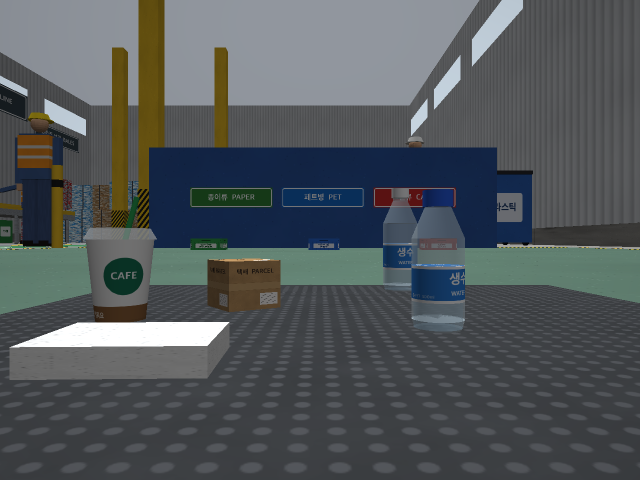
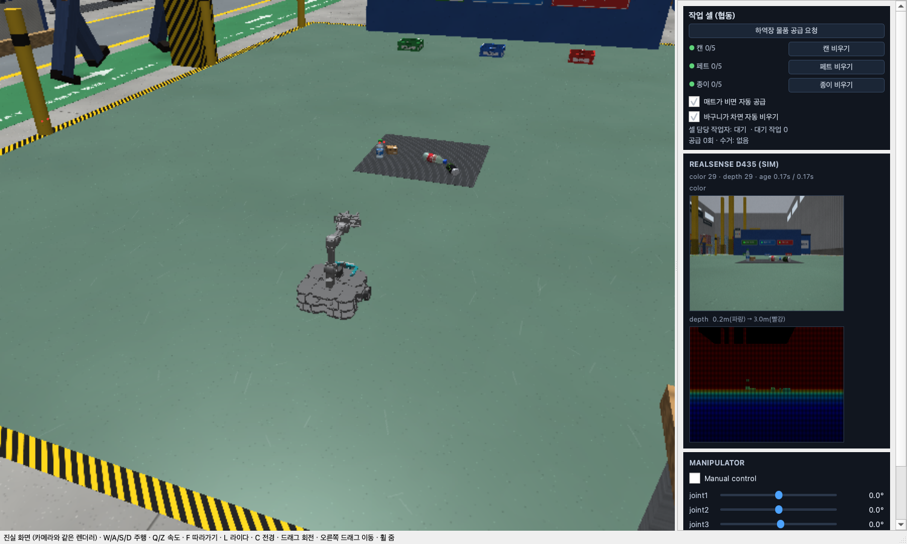
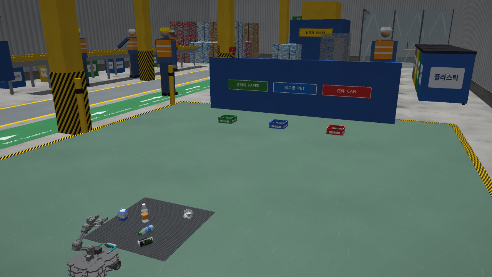

# srf-recycling-ws — 재활용품 분리수거

SRF로 만드는 미션 워크스페이스. 로봇이 작업 영역의 캔·페트병·종이를 인식하고 집어서 종류별 분리수거함으로 옮긴다.

- 미션 명세서(초안): [documents/mission.md](documents/mission.md)
- 프로젝트 3 발제 정리: [documents/brief.md](documents/brief.md)
- 로봇: ROBOTIS TurtleBot3 Manipulation(Waffle Pi + OpenMANIPULATOR-X) + 전방 RealSense D435 — [`engine/description/turtlebot3_manipulation_description`](engine/description/turtlebot3_manipulation_description/README.md) (`waffle-mpx-lyrical`의 xacro·메시를 그대로, xacro로 펼친 URDF)

로봇 스택(`engine/`), 하드웨어 스텁(`simulator/hardwares/`), OpenCR 펌웨어(`firmware/`), 웹 Viz(`viz/web/`)는 `srf-default-ws`에서 복사해 시작했다 (이 프로젝트에서 따로 관리).

## 시뮬레이터 — 재활용 선별장



```bash
./run-simulator.sh                                   # 정상 장면, 시드 42
./run-simulator.sh --seed 7 --scene multi --target can --items 5 --distractors 2
./run-simulator.sh --people 0 --forklifts 0          # 사람·지게차 없이
./run-simulator-vizweb.sh                            # 시뮬레이터 + 웹 Viz (http://localhost:8080/)
```

24 × 14 m 실내 선별장 (공통 맵 추첨 전 임시 배치 — `RecyclingLayout`, `simulator/world/facility.cpp`):

| 구역 | 들어 있는 것 |
|---|---|
| 로봇 분리수거 셀 (x 1~9, y 1~6.8) | 에폭시 바닥·위험 테이프 경계, **작업 매트**(3.6~4.4, 3.5~4.3) 위 미션 물품, **수거 바구니** 캔(빨강)·페트(파랑)·종이(초록) x 7.6, 칸막이와 표지판, 볼라드, 작업대. 로봇 시작 (2.2, 3.9) |
| 보행자 통로 · 지게차 통로 | 초록 통로(화살표·글씨), 노란 경계선, 기둥(위험 띠·소화기) |
| 하역장 | 셔터 2개, 혼합 재활용품 마대, 팔레트·박스 더미 |
| 선별 컨베이어 | **움직이는 벨트**와 흘러가는 물품, 투입 호퍼, 작업자 3명(집는 동작), 낙하 수레 |
| 압축 베일 적재장 · 압축기 | 골판지·페트·캔 베일 더미, 압축기와 조작반 |
| 대형 수거함 구역 · 사무실 | 1100 L 수거함(라벨), 유리병 철망 케이지, 유리벽 사무실(책상·모니터) |

**움직이는 것** (라이다·카메라에 보인다 — 장애물 정지·우회 시험):
- 걷는 작업자 최대 4명 (`--people`): 통로 왕복, 하역장↔통로, **셀 점검**(작업 매트와 바구니 사이를 지나간다), 수거함 구역. 앞에 로봇·사람이 있으면 기다린다.
- 지게차 (`--forklifts`): 하역장 ↔ 적재장 왕복, 끝에서 포크를 올리고 내림, 앞에 사람·로봇이 있으면 멈춤.
- 컨베이어 위 물품, 컨베이어 작업자.

### 협동 작업 — 셀 담당 작업자 (파란 안전모)

로봇 혼자가 아니라 사람과 같이 일하는 셀이다. 셀 북서쪽 구석(0.7, 5.5)에 대기하던 작업자가:

| 일 | 언제 | 하는 것 |
|---|---|---|
| **공급** | 매트가 (물품이 있다가) 비면 자동, 또는 요청 | 하역장 마대에서 토트에 담아 → 매트 북쪽에서 붓는다 (`--supply-items`개 + 비대상 `--distractors`개) → 돌아온다 |
| **비우기** | 바구니가 `--bin-capacity`(기본 5)개가 되면 자동, 또는 요청 | 바구니 앞에서 비워 → 종류별 대형 수거함(페트·종이·캔)에 붓고 → 돌아온다 |



- 칸막이 램프: 초록 여유 · 주황 하나 남음 · 빨강 꽉 참 · **파랑 깜빡임 = 작업자가 비우러 옴**. 칸막이 끝에 작업자 호출 패널
- 진실 화면 오른쪽 **작업 셀 패널**: 공급 요청 · 캔/페트/종이 비우기 버튼, 자동 공급·비우기 켜고 끄기, 바구니 채움, 작업자 상태, 수거 누계
- 서비스 `recycling/request` (String JSON): `{"action":"supply"}`, `{"action":"empty","bin":"can"}` — LLM·로봇 작업 관리자가 부른다 (실물에서는 작업자 호출 알림이 된다)
- 작업자는 앞에 로봇이 있으면 기다린다. 로봇도 작업자를 장애물로 보고 피해야 한다 (협동 안전)
- 옵션: `--no-auto-supply`, `--no-auto-empty`, `--bin-capacity N`, `--supply-items N`. 진실값 JSON의 `cell`에 바구니 채움·작업자 상태·대기 작업·공급 횟수·수거 누계

### 미션 물품

| 종류 | 변형 (라벨은 텍스처로 인쇄) |
|---|---|
| 캔 | 음료캔(콜라·사이다·커피·맥주·에너지, 찌그러진 것 포함), 참치캔 |
| 페트 | 생수·탄산수·녹차·오렌지 (투명, 남은 물, 뚜껑 색), 작은 병 |
| 종이 | 우유팩, 택배 상자, 종이컵, 구긴 종이·신문, 말린 신문 |
| 불확실 (`unknown`) | 플라스틱 뚜껑+빨대 달린 종이컵, 알루미늄 멸균팩 — 분류 보류 대상 |
| 비대상 (`other`, `--distractors`) | 유리병(갈색·초록), 비닐, 스티로폼 |

### 장면 (`--scene`, `--target`, `--items`, `--distractors`, `--seed`)

같은 시드면 물품·작업자 배치가 같다 (회차 재현). 물품은 작업 매트 안에 겹치지 않게 임의 위치·방향, 원기둥 물품은 절반 확률로 눕는다.

| 장면 | 만드는 것 | 발제 판정 |
|---|---|---|
| `normal` | `--target`이 있으면 대상이 정확히 하나, 없으면 세 종류가 다 나온다 | 정상: 선택 |
| `multi` | 같은 종류 후보 둘 이상 | 미션: 접근·집기 쉬운 것부터 / 발제의 모호(후보 2개 이상) 시험에도 쓴다 |
| `ambiguous` | 불확실 물품 하나 + 나머지 | 모호: 보류 |
| `absent` | `--target` 종류가 없다 (대상 지정이 없으면 매트가 빈다) | 부재: 보류 |

| normal | multi | ambiguous | absent |
|---|---|---|---|
|  |  |  |  |

### 렌더링 — 카메라와 진실 화면이 같다

`simulator/render/`의 3D 소프트웨어 렌더러(CPU만, Pi·CI·헤드리스에서 같은 결과)가 **로봇 카메라(D435 스텁)와 진실 화면을 같은 장면 데이터로** 그린다.

- 텍스처(UV)·픽셀 음영(부드러운 법선, 금속 광택)·투명(페트병·유리·비닐)·접지 그림자·2×2 슈퍼샘플링·멀티스레드·센서 잡음
- 텍스처는 Qt로 절차 생성 (`simulator/render/textures.cpp`): 콘크리트·에폭시·골판·브랜드 라벨(한글)·표지판·형광 조끼·베일 등. 외부 이미지 없음, 같은 이름이면 같은 그림
- 로봇은 URDF 메시를 관절 FK로 (팔·그리퍼가 카메라에 보인다). URDF의 `end_effector_link` 빨간 표시 상자는 실물에 없어서 뺀다
- 카메라: `camera/color/image_raw`(RGB8), `camera/depth/image_rect_raw`(16UC1 mm), 기본 424×240 @ 5 Hz, 수평 69°, `--no-noise`가 아니면 깊이 σ 5 mm·영상 잡음

| 진실 화면 (`./run-simulator.sh`) | 팔을 내린 카메라 | 사람 눈높이 |
|---|---|---|
|  |  |  |

진실 화면: 드래그 회전 · 오른쪽 드래그 이동 · 휠 줌 · W/A/S/D 주행(`cmd_vel_teleop`) · Q/Z 속도 · F 따라가기 · L 라이다 · C 전경. `--screenshot PATH`면 6초 뒤 창을 저장하고 끝낸다.

### 진실값과 재배치

- `recycling/truth` (String JSON, 2 Hz): 물품마다 `category`, `variant`, 위치, `lying`, `state`(`work_area`·`held`·`bin`·`floor`·`on_robot`), `bin`, `correct`, `bin_error_mm`(바구니 중심과의 거리), `dropped`, `releases` + `summary`
  - 바구니 안: 중심이 안쪽 1 cm 안 + 그리퍼에서 분리 + 테두리 아래
  - 낙하: 그리퍼에서 놓인 높이가 3 cm를 넘고 바구니 밖에 떨어짐
  - 시뮬레이터 진실값이다. 발제 판정은 **카메라 관측**으로 하고, 이 값은 그 판정을 검증하는 데 쓴다 (시뮬 성공은 실물 성공에 합산하지 않는다).
- `recycling/reset` 서비스 (String JSON): `{"seed":7,"scene":"multi","target":"can","items":5,"distractors":1,"people":2,"forklifts":1}` — 빠진 값은 지금 값. 웹 Viz에도 `recycling/truth`가 간다.

### 스냅샷 (헤드리스)

```bash
./build.sh simulator
build-mac/srf_recycling_ws_snapshot --seed 7 --target can --distractors 1 --out /tmp/snap \
    [--robot X,Y,YAW] [--arm J1,J2,J3,J4,GRIP] [--size 640,480] [--people N] [--forklifts N]
#   [--run SEC] [--request supply|empty:can]   (시간을 돌려 작업자·지게차가 움직인 뒤 찍는다)
# → color.png, depth.png(16bit mm), overview.png(홀 전경), cell.png(사람 눈높이), truth.json
```

로봇 자세·팔 관절·시드를 바꿔 여러 장을 만들면 VLM/VLA 데이터로도 쓸 수 있다.

## 머신러닝 (설계)

`simulator/ml/` — CPU만 쓰는 전제로 방식만 적어 두었다 (코드 없음):
[전체](simulator/ml/README.md) · [vlm](simulator/ml/vlm/README.md) (물품 선택·보류) · [vla](simulator/ml/vla/README.md) (접근·집기·놓기) · [llm](simulator/ml/llm/README.md) (intent 설계, 제공자 비교 방법)

## 빌드·테스트

```bash
./build.sh            # Pi: robot+tools / PC: robot+tools+simulator+viz-web
./build.sh simulator  # 시뮬레이터 + 스냅샷
./run-tests.sh        # srf + 이 워크스페이스 (재활용 월드: 시드 재현·장면 규칙·배치·판정·카메라·작업자·지게차)
```

## 다음 단계

- 공통 맵 추첨 뒤 `RecyclingLayout`을 실제 배치로 바꾸고 SLAM 지도 만들기
- VLM 대상 선택(정상·모호·부재 보류) → 3D 위치(깊이 + TF) → Nav 이동 → VLA 접근·집기·놓기 → 카메라로 배치 확인
- 회차 ID로 영상·지시·모델 원출력·명령·판정을 bag에 같이 기록
