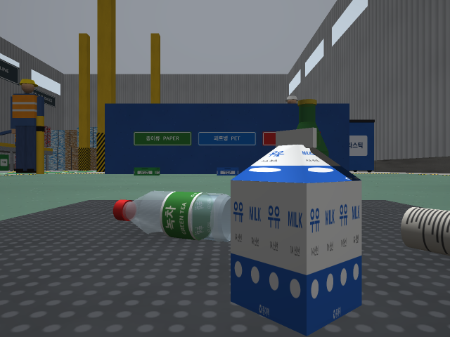
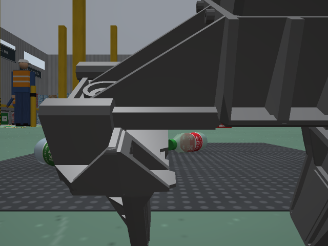

# srf-recycling-ws — 재활용품 분리수거

SRF로 만드는 미션 워크스페이스. 로봇이 작업 영역의 캔·페트병·종이를 인식하고 집어서 종류별 분리수거함으로 옮긴다.

- 미션 명세서(초안): [documents/mission.md](documents/mission.md)
- 프로젝트 3 발제 정리: [documents/brief.md](documents/brief.md)
- 로봇: ROBOTIS TurtleBot3 Manipulation(Waffle Pi + OpenMANIPULATOR-X) + 전방 RealSense D435 — [`engine/description/turtlebot3_manipulation_description`](engine/description/turtlebot3_manipulation_description/README.md) (`waffle-mpx-lyrical`의 xacro·메시를 그대로, xacro로 펼친 URDF)

로봇 스택(engine/)과 하드웨어 스텁(simulator/hardwares/)은 `srf-default-ws`에서 복사해 시작했다.

## 시뮬레이터


```bash
./run-simulator.sh                                   # 정상 장면, 시드 42
./run-simulator.sh --seed 7 --scene multi --target can --items 5
./run-simulator.sh --scene ambiguous --camera 640x480 --no-noise
./run-simulator-vizweb.sh                            # 시뮬레이터 + 웹 Viz (http://localhost:8080/)
```

| 구성 | 값 (공통 맵 추첨 전 임시 배치, `RecyclingLayout`) |
|---|---|
| 방 | 3.0 × 2.0 m, 벽 높이 0.5 m |
| 로봇 시작 | (0.45, 1.00), 정면 +x |
| 작업 영역 | x 1.25~2.05, y 0.60~1.40 (바닥 매트) |
| 분리수거함 | 안쪽 22 × 22 cm, 벽 10 cm, x = 2.80 — 캔(빨강) y 0.55 · 페트(파랑) y 1.00 · 종이(초록) y 1.45 |
| 물품 | 캔 Ø53×100 mm · 페트병 Ø56×170 mm · 종이(팩 55×55×95 mm 또는 구긴 종이 Ø60 mm) · 불확실(뚜껑 달린 종이컵) |

### 장면 (`--scene`, `--target`, `--items`, `--seed`)

같은 시드면 같은 배치다 (회차 재현). 물품은 작업 영역 안에 겹치지 않게 임의 위치·방향으로, 캔·병은 절반 확률로 눕는다.

| 장면 | 만드는 것 | 발제 판정 |
|---|---|---|
| `normal` | `--target`이 있으면 대상이 정확히 하나, 없으면 세 종류가 다 나온다 | 정상: 선택 |
| `multi` | 같은 종류 후보 둘 이상 | 미션: 접근·집기 쉬운 것부터 / 발제의 모호(후보 2개 이상) 시험에도 쓴다 |
| `ambiguous` | 분류가 불확실한 물품(복합 재질 종이컵) 하나 + 나머지 | 모호: 보류 |
| `absent` | `--target` 종류가 없다 (대상 지정이 없으면 작업 영역이 빈다) | 부재: 보류 |

| normal | multi | ambiguous | absent |
|---|---|---|---|
|  |  |  |  |

### 카메라 (D435 스텁)

URDF 메시(관절 FK)와 월드를 **3D 소프트웨어 렌더러**(`simulator/render/`, CPU만)로 `camera_color_optical_frame`에서 그린다. RGB8 + 깊이(16UC1, mm), 기본 424×240 @ 5 Hz, 수평 화각 69°. 팔을 앞으로 내리면 그리퍼가 보인다:



- 토픽: `camera/color/image_raw`, `camera/depth/image_rect_raw` (실기와 같은 RealSenseCamera 인터페이스)
- `--no-noise`가 아니면 깊이에 σ 5 mm 잡음
- URDF의 `end_effector_link` 빨간 표시 상자는 실물 카메라에 없으므로 카메라 영상에서 뺀다

### 진실값과 재배치

- `recycling/truth` (String JSON, 2 Hz): 물품마다 `category`, `variant`, 위치, `lying`, `state`(`work_area`·`held`·`bin`·`floor`·`on_robot`), `bin`, `correct`, `bin_error_mm`(수거함 중심과의 거리), `dropped`, `releases` + `summary`(정답·오분류·낙하·남은 수)
  - 수거함 안: 중심이 안쪽 1 cm 안 + 그리퍼에서 분리 + 테두리 아래
  - 낙하: 그리퍼에서 놓인 높이가 3 cm를 넘고 수거함 밖에 떨어짐
  - 시뮬레이터 진실값이다. 발제 판정은 **카메라 관측**으로 하고, 이 값은 그 판정을 검증하는 데 쓴다 (시뮬 성공은 실물 성공에 합산하지 않는다).
- `recycling/reset` 서비스 (String JSON): `{"seed":7,"scene":"multi","target":"can","items":5}` — 빠진 값은 지금 값

### 스냅샷 (헤드리스)

```bash
./build.sh simulator
build-mac/srf_recycling_ws_snapshot --seed 7 --scene normal --target can --out /tmp/snap \
    [--robot X,Y,YAW] [--arm J1,J2,J3,J4,GRIP] [--size 640,480]
# → color.png, depth.png(16bit mm), overview.png, truth.json
```

로봇 자세·팔 관절을 바꿔 여러 장을 만들면 VLM/VLA 데이터로도 쓸 수 있다.

## 빌드·테스트

```bash
./build.sh            # Pi: robot+tools / PC: robot+tools+simulator
./build.sh simulator  # 시뮬레이터 + 스냅샷
./run-tests.sh        # srf + 이 워크스페이스 (재활용 월드: 시드 재현·장면 규칙·배치·판정·카메라)
```

## 다음 단계

- 공통 맵 추첨 뒤 `RecyclingLayout`을 실제 배치로 바꾸고 SLAM 지도 만들기
- VLM 대상 선택(정상·모호·부재 보류) → 3D 위치(깊이 + TF) → Nav 이동 → VLA 접근·집기·놓기 → 카메라로 배치 확인
- 회차 ID로 영상·지시·모델 원출력·명령·판정을 bag에 같이 기록
